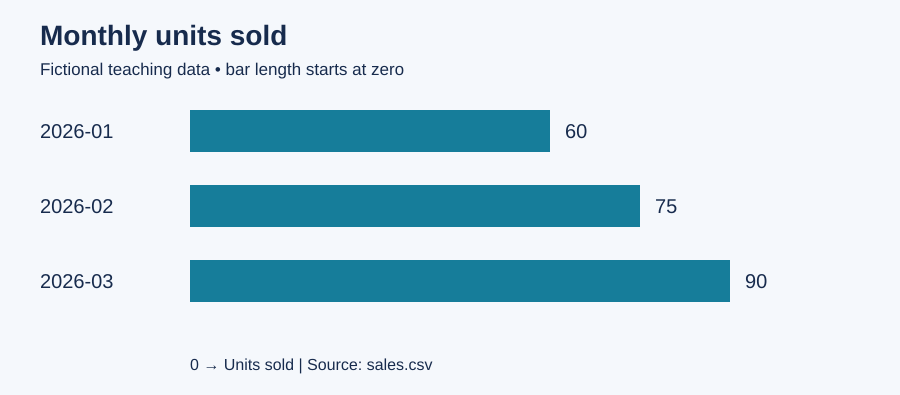

# Sales analysis report

**Fictional teaching dataset. No real shop or customer records.**

## Question
How did total units sold and sales revenue change across the supplied months?

## Method and checks
Each source row represents one product in one month. Revenue is units sold multiplied
by unit price. The script sums units and revenue by month, sorts months chronologically,
and checks column names, dates, nonnegative values and duplicate month/product pairs.
The supplied dataset contains 9 records. No rows were removed or imputed.
These checks do not prove that a real-world source is accurate or complete.

## Results
| Month | Units sold | Revenue (NGN) |
| --- | ---: | ---: |
| 2026-01 | 60 | 20,500 |
| 2026-02 | 75 | 25,500 |
| 2026-03 | 90 | 30,500 |

- Total units sold: **225**.
- Total revenue: **NGN 76,500**.
- Units changed from 60 in 2026-01 to 90 in 2026-03: **50.0%**.
- Percentage change = (last value - first value) / first value × 100.

## Interpretation and limits
The original example shows rising monthly sales. This describes the supplied sample;
it does not establish why sales changed or predict future demand. The data has only
three months, three products and deliberately simple values. Revenue is not profit:
costs, discounts, returns and tax are not included. No causal or market claims are made.

## Next analytical step
For a real project, obtain authorized records for a longer period, check missing months,
and examine prices, stock availability and promotions before recommending purchases.
